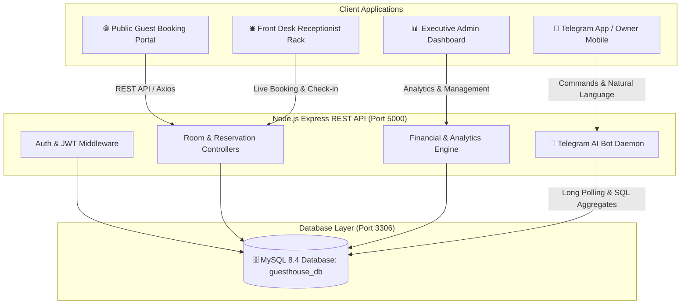

# 🏨 Serene Haven — Luxury Guest House Management & AI Telegram Reporting Bot

[](https://reactjs.org/)
[](https://getbootstrap.com/)
[](https://nodejs.org/)
[-4479A1?logo=mysql&logoColor=white)](https://www.mysql.com/)
[](https://core.telegram.org/bots)
[-brightgreen)](file:///scratch/comprehensive_qa_audit.mjs)

A full-stack, enterprise-grade **Guest House Management & Online Reservation System** equipped with real-time room availability synchronization, front-desk receptionist visual rack, comprehensive financial reporting, and an **AI Telegram Reporting Bot** supporting natural language queries (Roman Urdu & English) and instant 1-tap mobile reports.

---

## 📌 Repository Overview

| Property | Details |
| :--- | :--- |
| **Short Description** | Production-ready full-stack Guest House & Hotel Management System with real-time front desk visual rack, MySQL database, and AI Telegram Bot for automated financial & occupancy reporting. |
| **Topic Tags** | `react`, `typescript`, `nodejs`, `express`, `mysql`, `vite`, `bootstrap5`, `hotel-management`, `pms`, `booking-system`, `telegram-bot`, `natural-language-processing`, `financial-reports` |
| **Architecture** | Decoupled Client-Server (Vite React SPA + Express REST API + MySQL Pool) |

---

## 🏗️ System Architecture



---

## ✨ Core Features & Portals

### 1. 🌐 Public Guest Portal (Online Booking Engine)
- **Dynamic Search Bar**: Check-in / check-out date range picker, guest counter, and real-time room type filter.
- **Featured Accommodations**: Dynamic room cards with pricing, ratings, bed configuration, square footage, and amenities.
- **Detailed Room Showcase (`/rooms/:id`)**: High-res image galleries, room specs, house rules, cancellation policies, and dynamic pricing calculator.
- **4-Step Booking Wizard (`/booking`)**:
  1. *Guest Details*: Formik + Yup validated customer input.
  2. *Stay Review*: Nightly breakdown, tax calculations, and discount application.
  3. *Secure Payment*: Credit/Debit Cards, Direct Bank Wire, Cash on Arrival, Easypaisa, and JazzCash.
  4. *Instant Voucher (`/booking/confirmation`)*: Official reservation folio with printable PDF layout and reference number (`GH-2026-XXXX`).

### 2. 🛎️ Front Desk Receptionist Visual Rack (`/admin/front-desk`)
- **Live Room Grid (Visual Rack)**: Real-time room status matrix with instant color coding:
  - 🟢 **Available** — Ready for walk-in or advance booking.
  - 🔴 **Occupied / Booked** — Displays guest name, stay dates, and quick check-out folio.
  - 🟡 **Maintenance** — Blocked for housekeeping or repairs.
  - 🔵 **Reserved** — Pre-booked for upcoming arrivals.
- **Real-Time Customer-to-Receptionist Sync**: Any booking finalized on the public guest screen immediately syncs to the receptionist screen and marks the room as **Occupied**.
- **Dynamic Date-Based Availability**: Changing walk-in check-in/out dates recalculates room rack availability on the fly.
- **Instant Walk-in Booking**: 1-click modal to register guests, select payment modes, and complete on-the-spot check-ins.
- **Double-Booking & Conflict Prevention**: Database-level and client-level transaction checks prevent overlapping stays (`409 Conflict`).

### 3. 📊 Executive Admin Portal & Financial Reports (`/admin`)
- **KPI Command Center**: Live metrics for Total Rooms, Available, Occupied, Today's Check-ins/outs, and Gross Revenue.
- **Visual Analytics**: Interactive responsive SVG charts for Revenue Trends, Occupancy Rate Gauge, and Monthly Booking Volumes.
- **Audited Financial Reports (`/admin/reports`)**:
  - Filter by Daily, Weekly, Monthly, or Custom Date Ranges.
  - Metrics include **Gross Revenue**, **Realized/Paid Revenue**, **Pending Receivables**, **ADR (Average Daily Rate)**, and **RevPAR**.
  - **Export to CSV (Excel)** and **Printable PDF Folios**.
- **Room & Category Inventory**: Full CRUD operations with Formik + Yup validation.
- **Guest CRM & Payment Ledger**: Lifetime spend tracking, stay histories, and multi-channel transaction audits.
- **Review Moderation & Staff Management**: Approve guest testimonials and manage employee roles (Admin, Manager, Receptionist, Housekeeping).

### 4. 🤖 AI Telegram Reporting Bot
- **24/7 Remote Hotel Intelligence**: Hotel owners and managers can request business reports directly via Telegram.
- **Natural Language Understanding (Roman Urdu & English)**:
  - *"aaj ki report"*, *"aaj ka hisab"*, *"today revenue"* ➔ **Daily Business Report**
  - *"is hafte ki report"*, *"hafte ka hisab"*, *"weekly summary"* ➔ **7-Day Financial Summary**
  - *"mahine ki report"*, *"is mahine ka hisab"* ➔ **Monthly Profit & Folio Report**
  - *"kamray"*, *"kitne rooms khali hain"*, *"room status"* ➔ **Live Visual Room Matrix**
  - *"kul hisab"*, *"total revenue"*, *"lifetime summary"* ➔ **Cumulative KPI Analytics**
- **Slash Commands**: `/start`, `/today`, `/week`, `/month`, `/rooms`, `/summary`.
- **Custom Reply Keyboard**: 1-tap buttons on mobile for effortless navigation without typing.
- **Auto-Reconnect & Proxy Ready**: Built-in resilient polling with auto-retry and custom `TELEGRAM_API_BASE` support for restricted network environments.

---

## 🛠️ Technology Stack

| Layer | Technologies |
| :--- | :--- |
| **Frontend** | React 18, TypeScript, Vite, React Router DOM v6, Bootstrap 5, Bootstrap Icons, Axios, Formik, Yup |
| **Backend** | Node.js (v20+), Express.js, TypeScript (`tsc`), tsx, CORS, dotenv, bcryptjs, jsonwebtoken |
| **Database** | MySQL 8.4 (using `mysql2` connection pool with promises) |
| **Bot Service** | Telegram Bot API, Native Fetch Long Polling, Markdown Parser |
| **Testing & QA** | Custom Node.js ES Module Integration Suites (16/16 Passed, Zero Type Errors) |

---

## 📂 Project Structure

```text
guesthouse-booking/
├── backend/
│   ├── src/
│   │   ├── config/
│   │   │   └── db.ts                   # MySQL connection pool & date formatting
│   │   ├── controllers/
│   │   │   ├── auth.controller.ts      # Authentication & JWT issuance
│   │   │   ├── booking.controller.ts   # Booking lifecycle, walk-ins, conflict check
│   │   │   ├── report.controller.ts    # Aggregated financial analytics & KPIs
│   │   │   └── room.controller.ts      # Room inventory & rack availability
│   │   ├── routes/
│   │   │   ├── auth.routes.ts
│   │   │   ├── booking.routes.ts
│   │   │   ├── report.routes.ts
│   │   │   ├── room.routes.ts
│   │   │   └── telegram.routes.ts      # Telegram bot webhook/reconnect endpoints
│   │   ├── services/
│   │   │   └── telegramBot.service.ts  # Telegram AI bot engine & NLP parser
│   │   └── server.ts                   # Express server entry point
│   ├── .env                            # Backend configuration (DB & Bot Token)
│   ├── package.json
│   └── tsconfig.json
├── src/
│   ├── components/                     # Reusable UI components & layouts
│   ├── context/                        # Auth & State contexts
│   ├── pages/
│   │   ├── admin/
│   │   │   ├── FrontDeskPage.tsx       # 🛎️ Receptionist Visual Room Rack
│   │   │   ├── ReportsPage.tsx         # 📊 Financial Reports & Telegram Hub
│   │   │   ├── AdminDashboard.tsx      # 📈 Executive KPI Dashboard
│   │   │   └── ...                     # Bookings, Rooms, Guests, Settings
│   │   ├── customer/                   # Customer dashboard & reservation history
│   │   └── public/                     # Home, Rooms, Room Details, Booking Wizard
│   ├── services/                       # Frontend API clients (Axios)
│   ├── App.tsx                         # Client routes & route guards
│   └── main.tsx
├── public/                             # Static assets & room images
├── .env                                # Frontend environment variables
├── package.json
└── vite.config.ts
```

---

## 🚀 Quick Start Guide

### Prerequisites
- [Node.js](https://nodejs.org/) (v18.0 or higher)
- [MySQL Server](https://dev.mysql.com/downloads/mysql/) (v8.0 or higher)
- [Git](https://git-scm.com/)

---

### 1. Database Setup
1. Start your MySQL service:
   ```bash
   # Windows (example)
   net start MySQL80
   ```
2. Log into MySQL and create the database:
   ```sql
   CREATE DATABASE guesthouse_db CHARACTER SET utf8mb4 COLLATE utf8mb4_unicode_ci;
   ```

---

### 2. Backend Installation & Setup
1. Navigate to the backend directory:
   ```bash
   cd backend
   npm install
   ```
2. Create and configure `backend/.env`:
   ```env
   PORT=5000
   NODE_ENV=development

   # Database Credentials
   DB_HOST=localhost
   DB_PORT=3306
   DB_USER=root
   DB_PASSWORD=your_password
   DB_NAME=guesthouse_db

   # JWT Secret
   JWT_SECRET=serene_haven_super_secret_jwt_key_2026
   JWT_EXPIRES_IN=7d

   # Telegram Bot (Optional: Obtain from @BotFather)
   TELEGRAM_BOT_TOKEN=your_telegram_bot_token
   # Optional: Set custom proxy base if Telegram is restricted
   # TELEGRAM_API_BASE=https://api.telegram.org
   ```
3. Initialize the database schema and seed default rooms, room types, and demo accounts:
   ```bash
   npm run db:init
   ```
4. Build and start the backend server:
   ```bash
   # Development mode with hot-reload
   npm run dev

   # Or production build
   npm run build
   npm start
   ```
   *The backend will be running at [http://localhost:5000](http://localhost:5000).*

---

### 3. Frontend Installation & Setup
1. Open a new terminal in the root directory:
   ```bash
   cd ..
   npm install
   ```
2. Create or verify `.env`:
   ```env
   VITE_API_BASE_URL=http://localhost:5000/api
   ```
3. Start the Vite development server:
   ```bash
   npm run dev
   ```
   *The application will open at [http://localhost:5173](http://localhost:5173).*

---

## 🤖 Telegram Bot Activation

1. Open Telegram and search for [`@BotFather`](https://t.me/BotFather).
2. Send `/newbot` and follow the prompts to choose a Bot Name and Username (e.g., `SereneHavenReportBot`).
3. Copy the HTTP API token provided by BotFather.
4. Paste the token into `backend/.env`:
   ```env
   TELEGRAM_BOT_TOKEN=1234567890:ABCdefGHIjklMNOpqrsTUVwxyz
   ```
5. Restart the backend (`npm start`). The bot will log:
   ```text
   [Telegram Bot] Successfully connected as @SereneHavenReportBot
   [Telegram Bot] AI Reporting Engine is active and listening for messages...
   ```
6. Open your Telegram app, search for your bot, send `/start`, and enjoy automated live hotel reports!

> [!TIP]
> **Regional Notice**: If direct access to `api.telegram.org` is restricted by your local ISP, turn on a VPN (such as [Cloudflare WARP 1.1.1.1](https://1.1.1.1/)) or specify a reverse proxy URL in `TELEGRAM_API_BASE`. The backend engine has automatic reconnect resilience built-in.

---

## 🔑 Default Credentials

| Portal | Email | Password | Role |
| :--- | :--- | :--- | :--- |
| **Admin & Receptionist** | `admin@example.com` | `admin123` | Administrator (Full Access) |
| **Customer Portal** | `customer@example.com` | `customer123` | Registered Guest |

---

## 🧪 Production Quality Assurance (QA)

This project has undergone rigorous senior-level automated testing covering:
- ✅ **API Health & Database Connectivity**: Full verification of all Express endpoints and MySQL connection pools.
- ✅ **Real-Time Booking Synchronization**: Public reservation checkout instantly reflects on the receptionist visual room rack.
- ✅ **Double-Booking & Conflict Validation**: Verifies overlapping date selections return `409 Conflict`.
- ✅ **Receptionist Walk-In Workflows**: Walk-in reservation, customer creation, and instant check-out folio settlement.
- ✅ **Date Boundary & Timezone Integrity**: Zero UTC shift bugs via MySQL `dateStrings: true` configuration.
- ✅ **TypeScript Strictness**: Zero TypeScript compiler errors across both frontend and backend.

---

## 📄 License
This project is licensed under the **ISC License**. Feel free to use and adapt it for hotel, resort, and guest house management projects.
